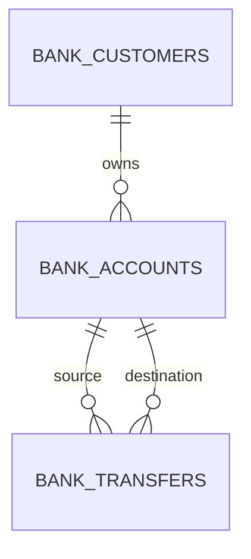

# Nexo — Laboratorio bancario FullStack

Aplicación académica para consultar cuentas, transferir dinero entre ellas, revisar movimientos y generar comprobantes QR. Integra una API REST transaccional, PostgreSQL y una interfaz React.

**Uso educativo local. Sin autenticación ni autorización. No exponer públicamente sin controles de seguridad ni utilizar datos o dinero reales.**

## Requisitos funcionales

- Listar cuentas y consultar saldos.
- Transferir importes positivos entre cuentas diferentes, verificando fondos.
- Consultar movimientos enviados y recibidos, de los más recientes a los más antiguos.
- Recuperar comprobantes mediante UUID.
- Generar QR, descargar comprobantes SVG e imprimir o guardar PDF.
- Presentar validaciones, errores, carga, estados vacíos y notificaciones.
- Documentar y probar la API mediante Swagger.

No hay endpoints para crear clientes, abrir cuentas o modificar saldos arbitrariamente. Los datos de demostración son opcionales y se cargan manualmente.

## Tecnologías y versiones verificadas

Comprobadas en la revisión del 12 de noviembre de 2026, salvo donde se indica:

| Componente | Versión |
|---|---|
| JDK Eclipse Temurin | 25.0.5 |
| Spring Boot y starters JPA, Web MVC y Validation | 4.1.2 |
| Maven / Wrapper | 3.10.0 / 3.3.4 |
| PostgreSQL | 17.12, comprobado en una etapa anterior; no revalidado con SQL en esta revisión |
| Springdoc OpenAPI | 3.2.0 |
| Node.js / npm | 24.22.3 / 11.19.1 |
| React / React DOM | 19.3.1 |
| TypeScript / Vite | 5.9.3 / 7.3.8 |
| Axios / React Hot Toast | 1.21.1 / 2.6.1 |
| qrcode.react | 4.2.0 |
| Vitest / Testing Library React / jsdom | 4.1.12 / 16.3.3 / 27.4.0 |
| jsQR, solo para pruebas | 1.4.0 |

Las dependencias Java se administran mediante el parent de Spring Boot, salvo Springdoc. JUnit Jupiter y Mockito llegan mediante los starters de pruebas. El frontend incluye resolución reproducible en `package-lock.json`; usar `npm ci`.

## Arquitectura por capas y directorios

Flujo: **React → Axios → controller → service → repository → PostgreSQL**.

```text
.
├── pom.xml
├── mvnw / mvnw.cmd
├── .mvn/wrapper/
├── src/main/java/com/tdea/laboratoriobanco/
│   ├── entity/       # Clientes, cuentas, transferencias y estados
│   ├── repository/   # Spring Data JPA
│   ├── service/      # Reglas de negocio y transacciones
│   ├── controller/   # API REST
│   ├── dto/          # Java Records
│   ├── exception/    # Excepciones y respuestas HTTP
│   └── config/       # CORS y OpenAPI
├── src/main/resources/
│   ├── application.properties
│   └── application-dev.properties
├── src/test/java/
├── frontend/
│   ├── src/components/  # Cuentas, formulario, historial y comprobante
│   ├── src/services/    # Cliente Axios
│   ├── src/receipt.ts   # Contenido QR y exportación
│   ├── src/types.ts
│   ├── src/styles.css
│   └── .env.example
├── scripts/
│   ├── demo-data.sql
│   └── banking-api.http
└── docs/
    ├── INFORME_LABORATORIO.md
    └── PROMPTS_UTILIZADOS.md
```

Los controladores devuelven DTO, no entidades. Las relaciones son unidireccionales, con carga diferida, y Open Session in View está desactivado.

## Modelo de datos

| Tabla | Campos y restricciones principales |
|---|---|
| `bank_customers` | ID autogenerado; nombre obligatorio (150); correo obligatorio y único (254) |
| `bank_accounts` | ID autogenerado; número obligatorio y único (34); saldo numeric(19,2); cliente obligatorio; versión optimista |
| `bank_transfers` | ID autogenerado; UUID obligatorio y único; cuentas origen/destino obligatorias; importe numeric(19,2); fecha Instant; estado textual |



Hay tres claves foráneas: cuenta-cliente, transferencia-origen y transferencia-destino. No se configuran borrados en cascada. Estados: PENDING, COMPLETED y FAILED. Un rechazo no crea un registro FAILED: se revierte toda la operación. Las validaciones de negocio en Java no deben confundirse con restricciones SQL.

## API REST

Base: `http://localhost:8080/api`.

| Método y ruta | Operación | Éxito |
|---|---|---|
| GET /accounts | Listar cuentas | 200 |
| GET /accounts/{id} | Consultar cuenta y saldo | 200 |
| POST /transfers | Transferir | 201 + Location |
| GET /transfers/{reference} | Consultar comprobante | 200 |
| GET /accounts/{id}/transfers | Historial descendente | 200 |

Solicitud de transferencia; sustituir ID por los consultados:

```json
{"sourceAccountId": 1, "destinationAccountId": 2, "amount": 25.00}
```

- `AccountResult`: id, accountNumber y balance.
- `TransferResult`: reference, sourceAccountNumber, destinationAccountNumber, amount, createdAt y status.
- `ApiError`: status, message, path y timestamp.

Los importes son números JSON. El modelo no declara una moneda. Respuestas de error: **400** entrada inválida; **404** recurso inexistente; **409** saldo insuficiente o conflicto de integridad/concurrencia; **500** error inesperado sin detalles internos. Los métodos HTTP no admitidos conservan códigos como 405.

## Transferencias, atomicidad y concurrencia

1. Validar importe positivo con máximo dos decimales e identificadores.
2. Rechazar cuentas iguales.
3. Bloquear ambas cuentas con PESSIMISTIC_WRITE, en orden ascendente de ID.
4. Comprobar existencia, fondos y capacidad monetaria del saldo destino.
5. Debitar y acreditar usando BigDecimal.
6. Crear UUID, fecha y registro COMPLETED, y ejecutar saveAndFlush.
7. Confirmar la transacción antes de devolver el resultado al llamador no transaccional.

El servicio usa `@Transactional(isolation = READ_COMMITTED, rollbackFor = Exception.class)`. Saldo origen, saldo destino y registro pertenecen a la misma transacción. **Flush no equivale a commit**: una excepción revierte lo escrito. Si se participa en una transacción externa, su llamador controla la confirmación final.

El orden de bloqueo reduce deadlocks. `@Version` aporta protección optimista adicional. No hay claves de idempotencia ni reintentos automáticos de POST: ante una respuesta incierta, consultar saldos e historial antes de reenviar.

## Comprobantes QR

TransferReceipt utiliza QRCodeSVG. Se abre tras una transferencia exitosa o después de consultar un UUID desde el historial. Un único generador produce JSON determinista con aplicación, tipo, versión, referencia, cuentas enmascaradas, importe, fecha y estado.

No incluye saldos, contraseñas, tokens ni nombres. El QR se genera en el navegador, sin servicios externos. Un lector muestra el JSON; no se codifica una URL de verificación. Se puede descargar el comprobante SVG o imprimirlo y guardar PDF.

**Es un comprobante académico, no una firma digital ni una garantía criptográfica de autenticidad.**

## Instalación y configuración segura

Instalar Git, **JDK 25** (con javac), **Node.js 24 o superior** con npm y **PostgreSQL 17**. pgAdmin es opcional. Maven global no es necesario: el Wrapper descarga su distribución. Se necesita Internet para instalar dependencias.

Clonar la URL del repositorio de entrega y entrar en su raíz. Verificar:

```powershell
java -version
javac -version
node --version
npm --version
.\mvnw.cmd -version
```

Si Java no coincide, establecer JAVA_HOME en la carpeta del JDK 25 instalado y anteponer su bin al PATH de esa terminal.

En pgAdmin, conectar al servidor local y crear `laboratoriobanco` si no existe. Su propietario debe tener permisos de conexión, uso del esquema y creación/actualización de las tablas del laboratorio. No modificar otras bases. Usar puerto 5432 o adaptar DB_URL.

El usuario postgres es válido para el laboratorio local; una instalación pública requiere privilegios mínimos. El backend lee variables del proceso: **no carga archivos .env automáticamente**.

| Variable | Valor o propósito |
|---|---|
| DB_URL | jdbc:postgresql://localhost:5432/laboratoriobanco |
| DB_USERNAME | Usuario configurado en PostgreSQL |
| DB_PASSWORD | Contraseña suministrada localmente |
| SPRING_PROFILES_ACTIVE | dev para desarrollo local |
| RUN_POSTGRES_TESTS | true para pruebas de integración PostgreSQL |
| VITE_API_BASE_URL | http://localhost:8080/api, en frontend |

### Terminal 1: backend

Desde la raíz, con Java 25 activo, en PowerShell:

```powershell
$env:DB_URL = 'jdbc:postgresql://localhost:5432/laboratoriobanco'
$env:DB_USERNAME = 'postgres'
$securePassword = Read-Host 'Contraseña de PostgreSQL' -AsSecureString
$env:DB_PASSWORD = [System.Net.NetworkCredential]::new('', $securePassword).Password
Remove-Variable securePassword
$env:SPRING_PROFILES_ACTIVE = 'dev'
.\mvnw.cmd -B compile
.\mvnw.cmd spring-boot:run
```

Backend: http://localhost:8080. Hibernate usa `ddl-auto=update` solo con perfil dev; por defecto, none. No se ejecutan scripts SQL automáticamente. SQL se muestra formateado.

En Linux/macOS usar `./mvnw` y definir las mismas variables en su shell. Si hace falta, habilitar el script con `chmod +x mvnw`.

Después del primer inicio, abrir `scripts/demo-data.sql` en Query Tool de pgAdmin conectado a laboratoriobanco y ejecutarlo completo, únicamente si se desean datos ficticios. Crea dos clientes y dos cuentas sin sobrescribir registros existentes. No garantiza ID 1 y 2.

### Terminal 2: frontend

Con Node 24 o superior activo:

```powershell
cd frontend
npm ci
Copy-Item .env.example .env.local
npm run dev
```

No sobrescribir .env.local si ya tiene configuración necesaria. Abrir **http://localhost:5173**. El puerto es fijo: Vite falla si está ocupado.

CORS permite exclusivamente ese origen en /api/**, GET y POST, durante dev. 127.0.0.1 y otros puertos no son equivalentes. Las variables VITE_* son públicas en el bundle; nunca colocar secretos. Solo el backend accede a PostgreSQL.

Detener servidores con Ctrl+C. Cerrar la terminal elimina sus variables; para retirar la contraseña antes: `Remove-Item Env:DB_PASSWORD`.

## Pruebas y builds

Frontend, desde frontend:

```powershell
npm test
npm run build
```

El build queda en frontend/dist. npm run preview sirve el bundle en otro puerto, que no está habilitado en CORS.

Backend completo, con DB_* configuradas y tablas creadas:

```powershell
$env:RUN_POSTGRES_TESTS = 'true'
.\mvnw.cmd -B test
```

Las pruebas PostgreSQL requieren exactamente la URL local indicada, DB_PASSWORD no vacía y RUN_POSTGRES_TESTS=true. Validan el esquema existente y eliminan únicamente sus registros de prueba.

Para ejecutar las pruebas independientes de PostgreSQL:

```powershell
.\mvnw.cmd -B '-Dtest=BankingApiTest,DevelopmentCorsTest,BankingQueryServiceTest,BankTransferServiceTest' test
```

Esta selección no sustituye la suite completa; contextLoads requiere base configurada.

**Resultados nuevos de etapa 8:** frontend 29 aprobadas y build exitoso; backend compilado con Java 25, 51 aprobadas, 4 omitidas y 1 error en la suite completa por ausencia de DB_URL en la sesión revisora. No se añadieron pruebas en esta etapa. Las verificaciones locales con PostgreSQL informadas por el estudiante son antecedentes, no nuevas ejecuciones de esta revisión. Véase el informe.

**Ejecución local aportada por el estudiante:** el [registro Maven público depurado](docs/evidencias/maven-local-publico.txt) documenta 56 pruebas aprobadas, sin fallos, errores ni omisiones y BUILD SUCCESS, el 12 de noviembre de 2026. Codex revisó el archivo, pero no ejecutó esa corrida local. El estudiante confirmó el comando `.\mvnw.cmd -B test 2>&1 | Tee-Object -FilePath docs/evidencias/maven-local.txt`, con perfil dev, DB_* y RUN_POSTGRES_TESTS=true. El original se conserva localmente y está excluido de Git por contener rutas personales. El [índice de evidencias](docs/evidencias/INDICE.md) enlaza las capturas y comprobantes PDF/SVG existentes. Las 29 pruebas frontend y su build fueron verificados en etapas anteriores; no hay un registro de consola frontend adjunto en evidencias.

## Swagger y comprobación manual

- [Swagger UI](http://localhost:8080/swagger-ui.html).
- [OpenAPI JSON](http://localhost:8080/v3/api-docs).
- Peticiones de ejemplo: scripts/banking-api.http.

Listar cuentas, elegir ID distintos, ejecutar POST y consultar UUID e historial. El POST modifica saldos; abrir, imprimir o descargar un comprobante no lo hace.

## Limitaciones académicas y entrega

- Sin autenticación, autorización, protección contra abuso ni auditoría de seguridad.
- Sin paginación, claves de idempotencia o migraciones versionadas.
- CORS no sustituye controles de acceso.
- No existe moneda declarada; el frontend limita importes a la precisión segura de JavaScript.
- Las fuentes web pueden requerir Internet; existe tipografía alternativa del sistema.
- Revisión móvil, lectura con teléfono y salida PDF requieren evidencia manual; no hay pruebas visuales automatizadas de navegador.
- El perfil dev y ddl-auto=update no son una estrategia de despliegue productivo.

Versionar código, Wrapper, scripts, documentación, package-lock.json y .env.example. Excluir secretos, .env.local, target, node_modules, dist, logs, claves y respaldos. .gitignore no elimina secretos ya versionados ni reemplaza la revisión del contenido preparado.

La publicación queda pendiente del estudiante: esta revisión no realiza commits ni push.

## Entregables y referencias

- [Informe técnico](docs/INFORME_LABORATORIO.md).
- [Registro de prompts recopilados](docs/PROMPTS_UTILIZADOS.md).
- [Índice de evidencias](docs/evidencias/INDICE.md).
- [Spring Boot: datasource](https://docs.spring.io/spring-boot/reference/data/sql.html).
- [PostgreSQL 17: bloqueos](https://www.postgresql.org/docs/17/explicit-locking.html).
- [Springdoc: compatibilidad](https://springdoc.org/#what-is-the-compatibility-matrix-of-springdoc-openapi-with-spring-boot).
- [Vite: variables de entorno](https://vite.dev/guide/env-and-mode).
- [qrcode.react](https://github.com/zpao/qrcode.react).
