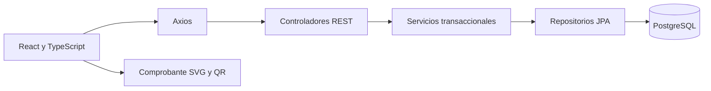
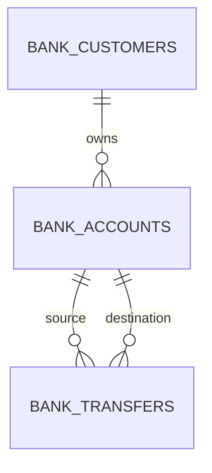
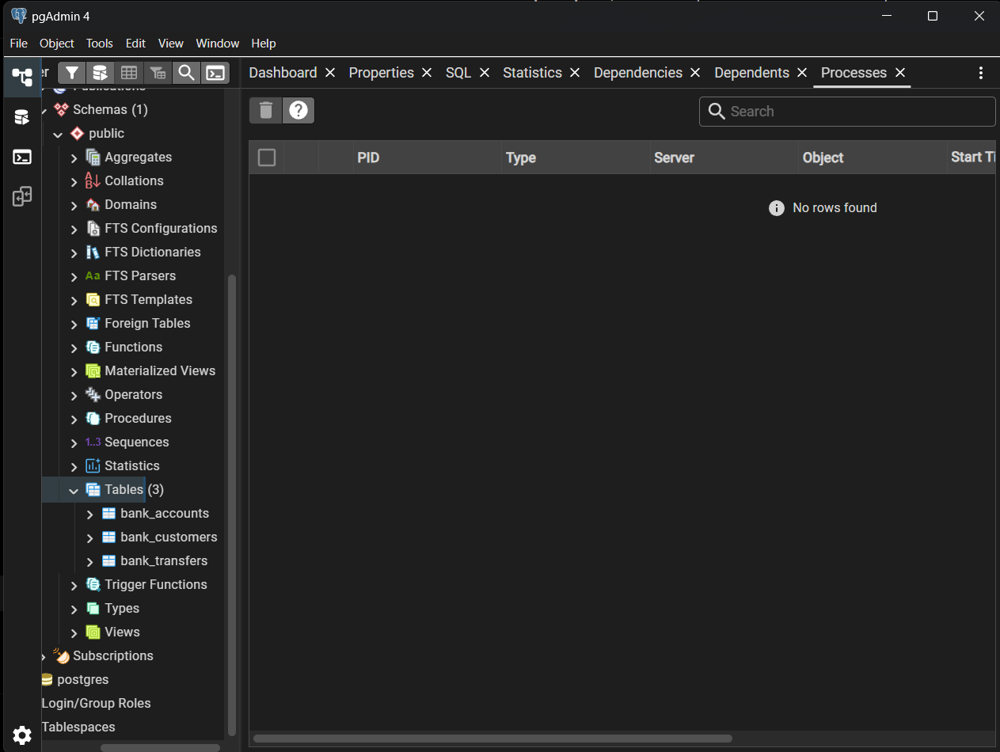
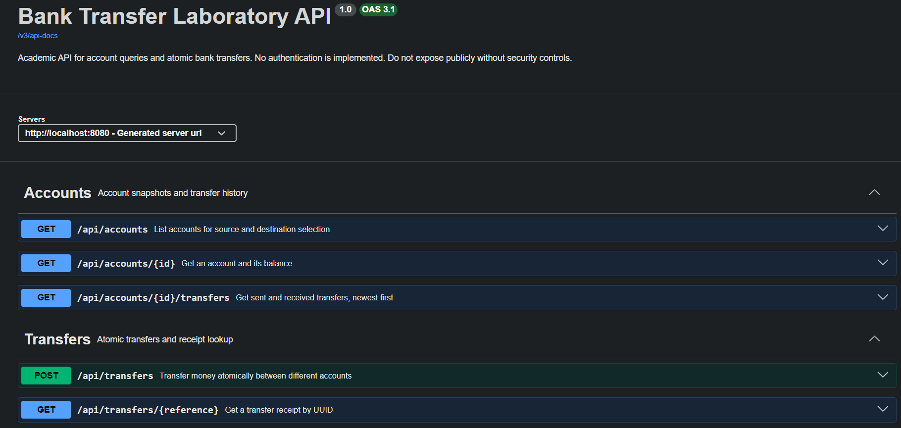
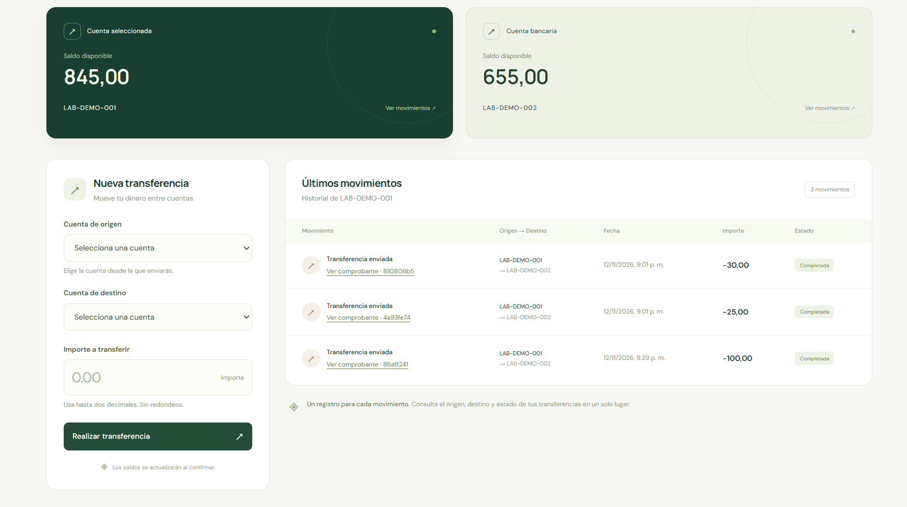
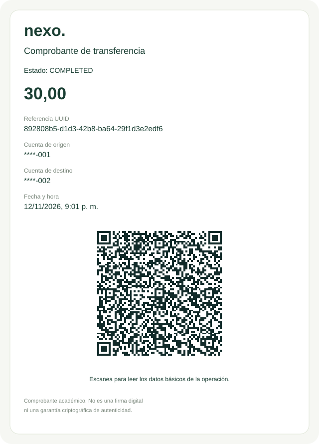

# Nexo — Laboratorio de Transferencias Bancarias

## Portada

| Campo | Información académica |
|---|---|
| Estudiante | Daniel Monsalve Valencia |
| Docente | DIEGO JOSE LUIS BOTIA VALDERRAMA |
| Asignatura | Diseño de Sistema |
| Institución | Tecnológico de Antioquia |
| Programa académico | Ingeniería |
| Semestre | 4 |
| Fecha de entrega | 12 de noviembre de 2026 |
| Publicación | Pendiente de autorización; repositorio existente con remoto origin |
| Commit de entrega | No creado; no se ha autorizado commit ni push |

**Título del proyecto:** Nexo — Laboratorio de Transferencias Bancarias.

Este documento describe el código revisado, incorpora los datos académicos confirmados y distingue las evidencias adjuntas de las verificaciones complementarias aún pendientes.

## 1. Introducción

Nexo es un laboratorio universitario que integra un backend Java con un frontend React y una base PostgreSQL. Permite consultar cuentas, transferir importes entre ellas, consultar un historial y producir comprobantes con QR. El sistema sirve para estudiar separación por capas, persistencia, validación, consumo de una API y consistencia transaccional.

El alcance es académico y local. La aplicación no incorpora autenticación y no representa un producto financiero listo para producción.

## 2. Justificación

Una transferencia modifica más de un registro y permite observar por qué una aplicación necesita atomicidad y control de concurrencia. Una implementación sin estas medidas podría descontar dinero sin acreditarlo o permitir que solicitudes simultáneas gasten el mismo saldo.

La interfaz web permite comprobar estos conceptos mediante peticiones HTTP. El historial y el comprobante facilitan revisar el resultado; el QR presenta una forma estructurada de transportar sus datos básicos.

## 3. Objetivos

### Objetivo general

Desarrollar una aplicación FullStack que realice transferencias entre cuentas de una única base de datos, conserve la consistencia de los saldos y permita consultar comprobantes desde una interfaz web.

### Objetivos específicos

1. Modelar clientes, cuentas y transferencias con JPA.
2. Separar persistencia, reglas de negocio y acceso HTTP.
3. Validar importes, fondos y cuentas antes de transferir.
4. Aplicar transacciones y bloqueos para prevenir inconsistencias.
5. Integrar React con la API mediante Axios y DTO conocidos.
6. Generar y exportar comprobantes con QR sin incluir secretos.
7. Verificar reglas y contratos mediante pruebas automatizadas.
8. Documentar la instalación y preparar una entrega reproducible.

## 4. Tecnologías utilizadas

La revisión actual comprobó JDK 25.0.5, Maven 3.10.0, Wrapper 3.3.4 y Spring Boot 4.1.2. El backend utiliza Spring Data JPA, Validation, Web MVC y el driver PostgreSQL con alcance runtime. Springdoc 3.2.0 proporciona OpenAPI y Swagger UI.

El frontend utiliza React 19.3.1, TypeScript 5.9.3, Vite 7.3.8, Axios 1.21.1, React Hot Toast 2.6.1 y qrcode.react 4.2.0. Se verificó con Node 24.22.3 y npm 11.19.1. Las dependencias exactas se conservan en package-lock.json.

Las pruebas Java emplean JUnit Jupiter y Mockito. El frontend usa Vitest 4.1.12, Testing Library React 16.3.3 y jsdom 27.4.0. jsQR 1.4.0 se utiliza exclusivamente como lector independiente para verificar los QR.

PostgreSQL 17.12 se identificó en una etapa anterior. El estudiante informó conexión y operaciones locales satisfactorias; en esta revisión no se realizó una consulta SQL autenticada nueva por ausencia de DB_*.

## 5. Arquitectura



- **entity:** BankCustomer, BankAccount, BankTransfer y TransferStatus.
- **repository:** interfaces JpaRepository y consultas de lectura/bloqueo.
- **service:** BankAccountService y BankTransferService.
- **controller:** BankAccountController y BankTransferController.
- **dto:** Records para entrada, salida y errores.
- **exception:** errores de negocio y RestControllerAdvice.
- **config:** documentación OpenAPI y CORS de desarrollo.

Los controladores no exponen entidades y no contienen los movimientos de saldo. Las lecturas convierten las entidades a DTO dentro del servicio, con transacciones de solo lectura. El frontend se encuentra en una carpeta independiente y no necesita credenciales de base de datos.

## 6. Modelo de base de datos



| Entidad / tabla | Diseño |
|---|---|
| BankCustomer / bank_customers | Long autogenerado; fullName obligatorio; email obligatorio y único |
| BankAccount / bank_accounts | Long autogenerado; accountNumber único; balance BigDecimal numeric(19,2); customer obligatorio; version con @Version |
| BankTransfer / bank_transfers | Long autogenerado; reference UUID único; sourceAccount y destinationAccount obligatorias; amount BigDecimal numeric(19,2); createdAt Instant; status textual |

Las relaciones ManyToOne son unidireccionales y LAZY. No se agregaron colecciones inversas ni borrado en cascada. La ausencia de una colección de cuentas en BankCustomer no impide que varias cuentas referencien el mismo cliente.

Las anotaciones de persistencia definen nulabilidad, unicidad, precisión y claves foráneas. Las reglas de saldo suficiente o cuentas diferentes se comprueban en el servicio y no deben interpretarse como restricciones SQL verificadas en esta revisión.

## 7. Desarrollo del backend

Los repositorios proporcionan búsqueda por correo, número de cuenta y UUID, además de historial entrante/saliente. Se conserva una consulta cronológica ascendente y se añadió otra descendente para la API; esta última carga las dos cuentas del movimiento.

BankAccountService entrega cuentas y saldos. BankTransferService realiza transferencias y obtiene comprobantes e historial.

| Endpoint | Función |
|---|---|
| GET /api/accounts | Listar cuentas |
| GET /api/accounts/{id} | Consultar saldo |
| POST /api/transfers | Crear transferencia |
| GET /api/transfers/{reference} | Recuperar comprobante |
| GET /api/accounts/{id}/transfers | Consultar movimientos recientes |

TransferRequest contiene sourceAccountId, destinationAccountId y amount. TransferResult contiene reference, sourceAccountNumber, destinationAccountNumber, amount, createdAt y status. Los DTO son Records; Jakarta Validation valida la entrada HTTP.

La conexión toma DB_URL, DB_USERNAME y DB_PASSWORD del entorno. Hibernate actualiza el esquema únicamente en el perfil dev; fuera de él la opción es none. Los scripts SQL no se ejecutan automáticamente y Open Session in View está desactivado. DevelopmentCorsConfig permite solo http://localhost:5173 en dev, GET y POST sobre /api/**.

## 8. Desarrollo del frontend

App coordina consultas, cuenta seleccionada, transferencias y apertura de comprobantes. AccountCard muestra una cuenta; TransferForm gestiona selección e importe; TransferHistory presenta movimientos; TransferReceipt concentra la visualización y exportación del comprobante.

El cliente Axios utiliza VITE_API_BASE_URL, con valor local predeterminado http://localhost:8080/api. Después de una transferencia exitosa actualiza cuentas e historial. Un error de red no provoca un reenvío automático del POST.

El formulario utiliza bloqueo de envío mientras procesa, valida cuentas diferentes e importes y limita valores que no conservan precisión segura en JavaScript. Los mensajes se muestran mediante Toast. Las consultas de historial se cancelan al cambiar la cuenta para evitar presentar respuestas antiguas.

## 9. Funcionamiento de las transferencias

1. Recibir el Record con identificadores e importe.
2. Comprobar importe positivo, precisión e identificadores válidos.
3. Rechazar la misma cuenta como origen y destino.
4. Bloquear las dos cuentas por ID ascendente y comprobar existencia.
5. Verificar fondos y que el saldo destino no exceda numeric(19,2).
6. Restar y sumar mediante BigDecimal.
7. Crear BankTransfer con UUID, Instant y estado COMPLETED.
8. Ejecutar saveAndFlush y confirmar la transacción antes de entregar el resultado al llamador no transaccional.

No se registra una transferencia completada visible de forma independiente a los saldos: la escritura pertenece a la misma transacción. Una operación rechazada no genera automáticamente un registro FAILED.

## 10. Errores, rollback y concurrencia

El servicio usa @Transactional con READ_COMMITTED y rollbackFor=Exception.class. Flush sincroniza escrituras, pero no confirma. La prueba de integración de rollback provoca una excepción después del flush dentro de una transacción externa y comprueba saldos e historial desde nuevas lecturas.

El repositorio usa PESSIMISTIC_WRITE. Las solicitudes que comparten cuentas deben coordinarse mediante los bloqueos de PostgreSQL; adquirir primero el menor ID reduce el riesgo de deadlocks. @Version conserva protección optimista adicional. Esto no elimina todos los posibles conflictos del sistema; los errores de concurrencia se traducen a una excepción de negocio.

Las excepciones abarcan cuenta inexistente, importe inválido, cuenta idéntica, fondos insuficientes, conflicto de concurrencia y transferencia inexistente. ApiExceptionHandler traduce errores a 400, 404, 409 y 500 sin entregar trazas ni credenciales. Los errores MVC mantienen códigos como 405.

## 11. Generación de comprobantes QR

receiptPayload define un formato JSON versionado y determinista. Incluye aplicación Nexo, tipo académico, UUID, cuentas enmascaradas, importe, fecha y estado. Una lista explícita de campos evita incorporar accidentalmente saldos, nombres o propiedades adicionales.

QRCodeSVG genera un código real con margen de lectura y alto contraste. Se utiliza el mismo contenido para transferencias nuevas e históricas. Las históricas se recuperan mediante GET por UUID; no se ejecuta de nuevo el movimiento.

Se descarga un SVG independiente con datos y QR o se imprime el diálogo para guardar PDF. Los valores de texto se escapan al construir la exportación SVG. El QR no incorpora una firma digital: un tercero podría reproducir o modificar un comprobante. Su función es académica y descriptiva, no demostrar autenticidad.

## 12. Pruebas y resultados

### Ejecuciones nuevas de la etapa 8

Revisión realizada el 12 de noviembre de 2026, zona America/Bogota:

| Verificación | Resultado observado |
|---|---|
| npm test | 29 aprobadas, 5 archivos |
| npm run build | TypeScript y build Vite exitosos |
| mvnw.cmd -B compile con JDK 25 | Exitosa |
| mvnw.cmd -B test | 56 contabilizadas: 51 aprobadas, 4 omitidas, 1 error; BUILD FAILURE |

Detalle backend: BankingApiTest 27, DevelopmentCorsTest 3, BankingQueryServiceTest 6 y BankTransferServiceTest 15 aprobadas. BankTransferPostgresTest contiene 4 pruebas omitidas por sus condiciones de entorno. contextLoads produjo un error al configurar el datasource: DB_URL no estaba disponible en la sesión revisora.

No se modificaron las pruebas para ocultar este resultado y no se añadieron pruebas nuevas en la etapa 8. Los logs locales de esta revisión están en target/stage8-compile.log y target/stage8-tests.log; son artefactos ignorados por Git, no evidencias que ya estén publicadas.

### Cobertura funcional disponible

Las pruebas existentes cubren importe cero/negativo, precisión monetaria, cuentas ausentes/iguales, fondos, conservación del dinero, orden de bloqueo, traducción de errores, contratos HTTP y Swagger. Las pruebas PostgreSQL comprueban persistencia, historial, rechazo sin cambios, rollback después de flush y competencia simultánea por un saldo.

En frontend se verifican formulario, bloqueo de envíos repetidos, refresco de datos, errores, apertura de comprobantes y consulta histórica. Un lector independiente decodifica el QR mostrado y el incluido en la descarga SVG, contrastando su JSON. Se verifica la llamada a impresión. jsdom adapta el ciclo de diálogo, pero no es un motor visual ni verifica por sí mismo la composición PDF o móvil.

### Ejecución local aportada por el estudiante

El estudiante aportó el [registro Maven local](evidencias/maven-local-publico.txt). Su contenido confirma documentalmente **56 pruebas backend aprobadas, sin fallos, errores ni omisiones**, con BUILD SUCCESS y finalización el 12 de noviembre de 2026 a las 22:10:27 (-05:00). El registro muestra Java 25.0.5. Codex revisó el archivo, pero no ejecutó esa corrida local. La línea de comando original no aparece al inicio del archivo.

Estos resultados deben distinguirse de la **ejecución desde Codex de la etapa 8: 51 aprobadas, 4 omitidas y 1 error de configuración**, por falta de DB_* (DB_URL ausente). No se presenta la ejecución local como una comprobación directa de Codex.

El estudiante confirmó el comando original:

```powershell
.\mvnw.cmd -B test 2>&1 | Tee-Object -FilePath docs/evidencias/maven-local.txt
```

Se ejecutó el 12 de noviembre de 2026 con perfil dev, DB_* configuradas y RUN_POSTGRES_TESTS=true. El log respalda resultados, fecha y Java; el comando y la configuración fueron confirmados por el estudiante. La publicación utiliza maven-local-publico.txt, versión depurada que sustituye rutas y usuario locales mediante marcadores. El original se conserva sin cambios y se excluye de Git.

## 13. Evidencias del funcionamiento

Los archivos siguientes están presentes en [docs/evidencias](evidencias/INDICE.md). Las descripciones se limitan al contenido observado en las capturas, al XML del SVG y al registro Maven. No se inventan capturas adicionales ni fechas de captura desconocidas.

### Figura 1. Tablas del modelo bancario en PostgreSQL



La captura de pgAdmin muestra las tres tablas del esquema public: bank_accounts, bank_customers y bank_transfers. Es evidencia visual de su existencia; no muestra el detalle de sus columnas, restricciones o claves foráneas. El nombre de la base no se aprecia en el recorte.

### Figura 2. Documentación de los endpoints con Swagger



Se observan las cinco operaciones de Accounts y Transfers, el servidor local localhost:8080 y la advertencia de API académica sin autenticación. La imagen muestra el catálogo de operaciones, no una respuesta HTTP ejecutada.

### Figura 3. Interfaz Nexo e historial de transferencias



La interfaz muestra las cuentas de demostración LAB-DEMO-001 y LAB-DEMO-002 con saldos de 845,00 y 655,00. En el historial de la primera cuenta aparecen tres transferencias enviadas y completadas, por 30,00, 25,00 y 100,00, con acceso a sus comprobantes. Esta misma captura respalda la interfaz principal y el historial; no se requiere fingir una imagen separada para cada apartado.

La suma visible de saldos es 1.500,00, coincidente con la suma inicial del script de demostración. La captura aislada no demuestra por sí sola todas las propiedades de concurrencia o rollback, que se estudian mediante las pruebas.

### Figura 4. Comprobante descargado con código QR



El SVG adjunto contiene la referencia 892808b5-d1d3-42b8-ba64-29f1d3e2edf6, estado COMPLETED, importe 30,00 y cuentas enmascaradas ****-001 y ****-002. La fecha mostrada es 12/11/2026, 9:01 p. m.; la referencia y el importe corresponden al primer movimiento visible en la figura 3. El comprobante incluye la advertencia de que el QR no es una firma digital ni una garantía criptográfica de autenticidad.

- [Abrir o descargar el comprobante SVG](evidencias/nexo-comprobante-892808b5-d1d3-42b8-ba64-29f1d3e2edf6.svg).
- [Abrir el PDF adjunto: Nexo · Laboratorio bancario](evidencias/Nexo%20%C2%B7%20Laboratorio%20bancario.pdf).

Se revisaron la cabecera, los metadatos y el texto extraíble del PDF de una página: contiene la misma referencia, importe 30,00 y cuentas enmascaradas que el SVG. No se detectaron autor ni asunto personales en sus metadatos, rutas personales o asignaciones de secretos en el texto. Conserva título, software creador/productor y fechas. Esta inspección no sustituye una revisión visual de impresión ni garantiza la ausencia de información oculta.

### Evidencia 5. Registro de pruebas Maven en el entorno local

[Consultar el registro Maven local completo](evidencias/maven-local-publico.txt).

El archivo registra: Tests run: 56, Failures: 0, Errors: 0, Skipped: 0; BUILD SUCCESS. Finaliza en 2026-11-12T22:10:27-05:00 y muestra Java 25.0.5. Incluye las cuatro pruebas BankTransferPostgresTest y contextLoads sin errores.

Esta evidencia documental respalda la ejecución local aportada por el estudiante. Revisar su contenido no equivale a haber ejecutado nuevamente esas pruebas desde Codex. Se conserva por separado el resultado histórico de la sesión Codex indicado en la sección 12.

### Evidencias complementarias aún no adjuntas

No hay capturas separadas de lectura del QR con teléfono o de diseño móvil, ni registro Vitest o copia del log histórico Codex en esta carpeta. Son complementos pendientes, sin enlaces ficticios. No se inventan fechas de captura. El comando Maven fue confirmado por el estudiante; las rutas personales se eliminaron únicamente de la copia pública, preservando el original y los resultados.


## 14. Revisión de seguridad y publicación

El repositorio ignora target, node_modules, dist, logs, .env y archivos locales, claves y respaldos. .env.example se conserva porque solo declara una URL pública. La conexión Java utiliza referencias a variables y no una contraseña literal.

La revisión de patrones no sustituye una auditoría exhaustiva. Antes de publicar se deben revisar los archivos preparados mediante git diff --cached. Ignorar archivos no elimina datos que ya estuvieran en el historial. El código de pruebas contiene textos ficticios de secretos para verificar que no se filtren: no son credenciales reales.

Al comenzar esta etapa la rama era main, existía el remoto origin y solo README.md estaba versionado. Los archivos de implementación estaban sin seguimiento. No se hizo commit, push ni se creó otro repositorio; la publicación requerida sigue pendiente de autorización y revisión del estudiante.

## 15. Conclusiones

El código integra las capas necesarias para el laboratorio: persistencia relacional, servicios transaccionales, API, cliente React y comprobantes. Las pruebas ejecutadas en esta revisión verifican las partes independientes de PostgreSQL y el build del frontend.

La suite completa no pudo declararse aprobada en la ejecución histórica de Codex por falta de configuración de la base en esa sesión. El registro local ahora adjunto documenta 56 aprobadas sin errores ni omisiones. Las capturas y el SVG respaldan la existencia de tablas, la documentación API, la interfaz, el historial y el comprobante; las verificaciones visuales complementarias pendientes se identifican en el índice.

El proyecto ilustra atomicidad y coordinación entre operaciones concurrentes, pero no incluye las medidas de seguridad, idempotencia, migraciones o firma de comprobantes necesarias para un sistema financiero de producción.

## 16. Referencias técnicas

Consulta documental realizada el 12 de noviembre de 2026:

1. [Spring Boot: SQL Databases](https://docs.spring.io/spring-boot/reference/data/sql.html).
2. [Spring Data JPA: Locking](https://docs.spring.io/spring-data/jpa/reference/jpa/locking.html).
3. [Spring Framework: rollback declarativo](https://docs.spring.io/spring-framework/reference/data-access/transaction/declarative/rolling-back.html).
4. [PostgreSQL 17: Explicit Locking](https://www.postgresql.org/docs/17/explicit-locking.html).
5. [Springdoc: compatibilidad Spring Boot](https://springdoc.org/#what-is-the-compatibility-matrix-of-springdoc-openapi-with-spring-boot).
6. [Vite: variables de entorno](https://vite.dev/guide/env-and-mode).
7. [qrcode.react: repositorio del proyecto](https://github.com/zpao/qrcode.react).

Consultar el [README](../README.md) para comandos de instalación, ejecución y pruebas, y el [registro de prompts](PROMPTS_UTILIZADOS.md) para la trazabilidad del uso de Codex.
